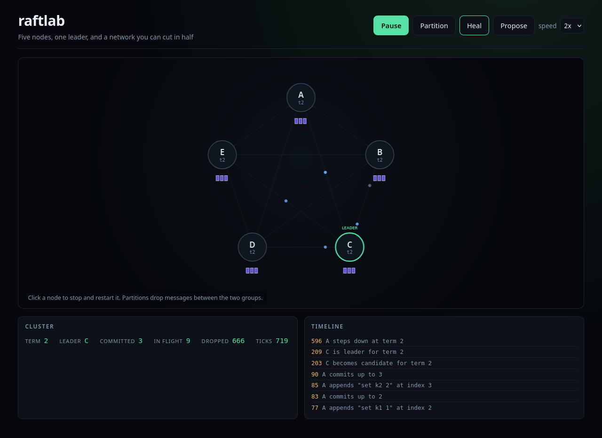
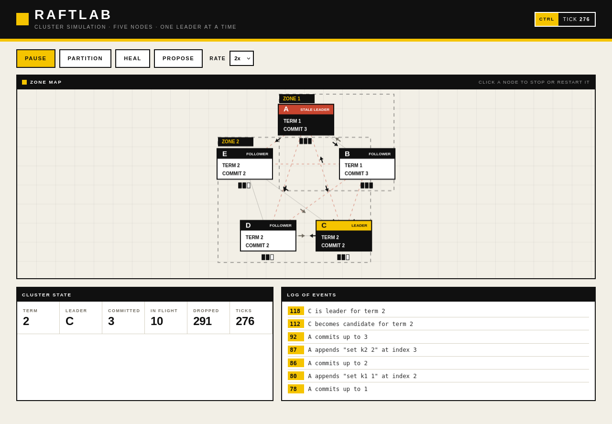

# raftlab

A five node Raft cluster you can watch, split and break, running in the browser.



Raft is easier to understand when you can see it move. Click Partition and the leader ends up in the minority: the other side elects a new leader while the old one carries on calling itself leader, because nothing has told it otherwise. Click Heal and it steps down.

Time is counted in ticks rather than seconds, so a seed replays a run exactly and the tests can assert on precise states.



## Run it

```bash
git clone https://github.com/TamiloreO/raftlab.git
cd raftlab
python3 -m http.server 8080
```

Then open http://localhost:8080/.

## What the signs mean

The leader has a yellow header and a stale leader wears red. Candidates are yellow, followers are white, and a stopped node is hatched. Dashed boxes are partitions, and the ticks under each node are log entries, filled for committed and hollow for still in flight.

The look borrows the wayfinding skin from [style-labs](https://tamiloreo.github.io/style-labs/?s=industrial-wayfinding).

## Tests

```bash
npm test
```

Ten tests on the safety properties rather than the happy path: one leader, matching logs, terms that never go backwards, a partitioned minority that cannot commit, and identical state from the same seed.

## Limits

No persistence, no log compaction, no membership changes, and the network drops messages across a partition but never reorders them. Each is on the roadmap.

[MIT](LICENSE) © Oluwatamilore Olufohunsi
